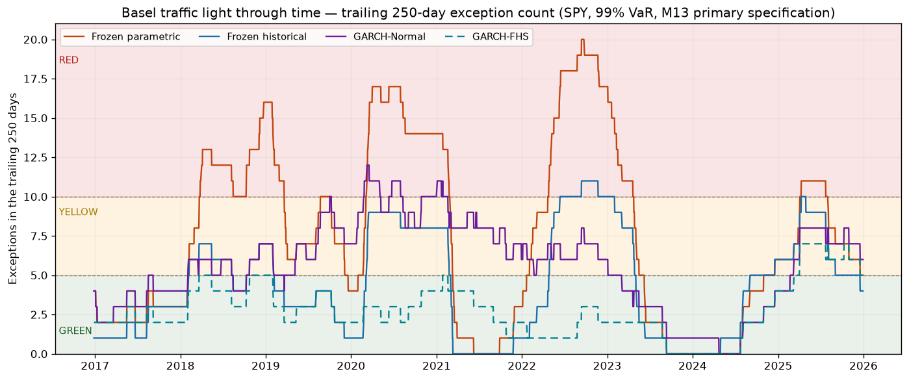

# M13 results — Volatility models

**Pre-registration:** `docs/design_m13.md` at `35008ca`, amended before
the out-of-sample run at `1af2fc5` (§16, "Pre-OOS amendments").

**The run:**
- M13.8, run once, at `e3121fc`, in the reference environment: Python
  3.11.16, numpy 2.4.6 (`np.log` on X86_V4), scipy 1.17.1, pandas 3.0.5,
  arch 8.0.0.
- 2,514 out-of-sample days, 2015-12-31 → 2025-12-30. 99% one-day VaR, so
  25.14 exceptions expected.
- Artefacts in `results/volatility/m13/`, committed exactly as written
  (`84d05fd`).

Every verdict below is the mechanical outcome of a pre-registered rule
(§10, with the §16 amendments). Nothing was chosen after the results were
seen. Each result is labelled as one of three kinds:

- **Descriptive difference:** a point estimate, rate or mean. It shows a
  direction; it is not a test.
- **Significant difference:** a Diebold–Mariano test that rejects after
  Holm within its pre-registered family (F1: volatility losses, 6 tests;
  F2: quantile loss, 13 tests; one of each per specification).
- **Backtest outcome:** Kupiec, Christoffersen, Basel zones,
  Acerbi–Székely. These test each series against its own claim, not
  against another series, and are not in the Holm families.

## 1. Hypotheses

All four are judged on the primary specification. W250 never decides a
hypothesis.

| | Rule (§10, §16) | Numbers that decide it | Verdict |
|---|---|---|---|
| **H1** | EWMA-Normal improves on Naive-Normal: the QL DM (F2, Holm) rejects in EWMA's favour **and** EWMA-Normal does not reject Christoffersen independence | DM −1.824, p 0.068, **Holm 0.550**; independence p 0.061 | **Not supported** |
| **H2** | GARCH is more responsive than Naive: the QLIKE DM (F1, Holm) favours GARCH | DM −3.631, p 2.9e-4, **Holm 0.0017** | **Supported** |
| **H3** | A better volatility forecast does not imply better coverage: the lowest-QLIKE model, mapped through Normal, rejects Kupiec | Lowest QLIKE is GARCH (−8.4525 vs EWMA −8.3882, Naive −8.0138). GARCH-Normal has 56 exceptions vs 25.14, **Kupiec p < 1e-6** | **Supported** |
| **H4** | FHS improves on Normal, per model: QL DM FHS vs Normal significant in FHS's favour (F2, Holm) **and** FHS passes Kupiec | Naive: DM −1.162, Holm 0.863, Kupiec p 0.573. EWMA: DM −1.238, Holm 0.863, Kupiec p 0.978. GARCH: DM −1.050, Holm 0.863, Kupiec p 0.573 | **Not supported** for any model |

**H2 measures accuracy, not reactivity.** The hypothesis is named "GARCH
is more responsive than Naive", but its rule tests forecast accuracy
(QLIKE over the full sample). The verdict "supported" is a statement
about accuracy. Reactivity has only descriptive support: in §4.2, GARCH's
σ̂ never reaches RV22 in 5 of the 16 high-vol episodes, against 13 for
Naive.

**H3, read with its descriptive companion.**
- The verdict stands as the rule gives it: the best volatility forecast,
  through a Normal tail, fails coverage.
- The pre-registered Spearman correlation between each series' QLIKE and
  its mean quantile loss is **ρ = 0.82** over the 12 series (0.82 within
  Normal, 0.75 within FHS). It is descriptive, with no p-value. Better
  volatility forecasts *do* tend to give better quantile loss.
- So the conclusion is **"necessary but not sufficient"**, not "does not
  imply". A better σ̂ improves the VaR ranking, and it is still not
  enough for coverage if the tail is wrong.

**H4: not supported.** The rule needs both conditions, and the first one
fails for all three models.
- **The backtests split cleanly:**
  - all three FHS series pass Kupiec (p 0.573, 0.978, 0.573);
  - all three Normal series reject it (p < 1e-6);
  - all three DMs point to FHS (negative statistic, lower mean QL);
  - none of those DMs is significant after Holm, and none even before it
    (raw p 0.25, 0.22, 0.29).
- **What the rule tied together:** a backtest outcome with a direct
  quantile-loss comparison of low power. The low power of the
  quantile-loss DM was anticipated in the design review, but it was not
  written into the pre-registration. Here the mean QL differences between
  FHS and Normal are 1.4e-5 to 4.4e-5, against mean losses of about 4e-4
  to 6e-4, and none comes close to significance even before Holm.

**Lessons for the M14 pre-registration:**
- A hypothesis about tail calibration should not be conditioned on a QL
  DM test whose power was never computed. Either pre-register the DM's
  power against a plausible effect, or state the hypothesis on the
  backtests it is about.
- Each hypothesis's name must match what its rule measures.

## 2. Decomposition (primary specification)

Each rung changes one thing from the one before it.

| Rung | Series | Exceptions | Rate | Kupiec p | Mean QL |
|---|---|---|---|---|---|
| Frozen parametric (sample mean, 250 days) | `frozen_parametric` | 72 | 2.86% | < 1e-6 | 5.718e-4 |
| (a) zero mean | Naive-Normal | 69 | 2.74% | < 1e-6 | 5.653e-4 |
| (b) volatility dynamics | EWMA-Normal / GARCH-Normal | 59 / 56 | 2.35% / 2.23% | < 1e-6 / < 1e-6 | 4.376e-4 / 3.915e-4 |
| (c) empirical tails | EWMA-FHS / GARCH-FHS | 25 / 28 | 0.99% / 1.11% | 0.978 / 0.573 | 4.010e-4 / 3.771e-4 |
| (c) for reference | Naive-FHS | 28 | 1.11% | 0.573 | 5.212e-4 |
| Reference | `frozen_historical` | 41 | 1.63% | 0.0036 | 5.069e-4 |

All descriptive.
- **Coverage:** the tail step (c) is the one that brings the exception
  count to the nominal 25.
- **Quantile loss:** the volatility step (b) is the one that lowers it.
- **Naive-FHS** has the right coverage with a quantile loss above the
  frozen historical method's.

## 3. Results

### 3.1 Risk (backtest outcomes, plus quantile loss as a descriptive figure)

| Series | Exc. | Rate | Kupiec p | Christoffersen ind. p | CC p | Basel full / worst rolling-250 | Mean VaR | Mean QL | AS Z2 | AS p |
|---|---|---|---|---|---|---|---|---|---|---|
| Naive-Normal | 69 | 2.74% | < 1e-6 | 0.0005 | < 1e-6 | red / red | 24,711 | 5.653e-4 | −2.679 | < 1e-4 |
| Naive-FHS | 28 | 1.11% | 0.573 | 8e-6 | 3.8e-5 | green / yellow | 36,114 | 5.212e-4 | −0.234 | 0.126 |
| EWMA-Normal | 59 | 2.35% | < 1e-6 | 0.061 | < 1e-6 | red / red | 22,609 | 4.376e-4 | −2.051 | < 1e-4 |
| EWMA-FHS | 25 | 0.99% | 0.978 | 0.024 | 0.078 | green / yellow | 31,577 | 4.010e-4 | −0.061 | 0.369 |
| GARCH-Normal | 56 | 2.23% | < 1e-6 | 0.525 | 1e-6 | red / red | 22,474 | 3.915e-4 | −1.678 | < 1e-4 |
| GARCH-FHS | 28 | 1.11% | 0.573 | 0.039 | 0.101 | green / yellow | 28,413 | 3.771e-4 | −0.178 | 0.184 |
| Naive-Normal W250 | 69 | 2.74% | < 1e-6 | 0.0005 | < 1e-6 | red / red | 24,711 | 5.653e-4 | −2.679 | < 1e-4 |
| Naive-FHS W250 | 48 | 1.91% | 4.7e-5 | 0.002 | 2e-6 | red / red | 39,060 | 5.696e-4 | −1.203 | < 1e-4 |
| EWMA-Normal W250 | 59 | 2.35% | < 1e-6 | 0.061 | < 1e-6 | red / red | 22,609 | 4.376e-4 | −2.051 | < 1e-4 |
| EWMA-FHS W250 | 31 | 1.23% | 0.257 | 0.059 | 0.089 | green / yellow | 30,676 | 3.988e-4 | −0.333 | 0.265 |
| GARCH-Normal W250 | 59 | 2.35% | < 1e-6 | 0.615 | < 1e-6 | red / red | 22,413 | 4.070e-4 | −1.969 | < 1e-4 |
| GARCH-FHS W250 | 39 | 1.55% | 0.010 | 0.148 | 0.013 | yellow / yellow | 26,694 | 3.924e-4 | −0.752 | 0.0093 |
| Frozen historical | 41 | 1.63% | 0.0036 | 0.0004 | 2.9e-5 | yellow / red | 30,444 | 5.069e-4 | −0.909 | 0.0020 |
| Frozen parametric | 72 | 2.86% | < 1e-6 | 0.001 | < 1e-6 | red / red | 24,190 | 5.718e-4 | −2.876 | < 1e-4 |
| Frozen Monte Carlo | 72 | 2.86% | < 1e-6 | 0.001 | < 1e-6 | red / red | 24,185 | 5.719e-4 | −2.873 | < 1e-4 |

**Reading the AS p column.** "< 1e-4" means no simulated Z2 of the 10,000
was as low as the observed one. The p-value is then at the method's floor,
1/10,001, and **those series are not ranked against each other** (§5).

*Trailing 250-day exception count against the Basel bands (0–4 green, 5–9
yellow, 10+ red at n = 250), in the style of the baseline's
`05_basel_zones.png`. Presentation only, drawn from the committed
artefacts.*

### 3.2 Volatility forecasts

| Model | MSE | QLIKE | MAE (secondary, never ranks) |
|---|---|---|---|
| Naive (primary = W250) | 2.860e-7 | −8.0138 | 1.638e-4 |
| EWMA, primary | 2.369e-7 | −8.3882 | 1.425e-4 |
| GARCH, primary | 2.037e-7 | **−8.4525** | 1.335e-4 |
| EWMA, W250 | 2.369e-7 | −8.3882 | 1.425e-4 |
| GARCH, W250 | 2.032e-7 | −8.3871 | 1.335e-4 |

**F1, Diebold–Mariano with Holm (m = 6).** A negative statistic favours the
first model.

| Test | Primary: DM / p / Holm | W250: DM / p / Holm |
|---|---|---|
| EWMA vs Naive, QLIKE | −3.236 / 0.0012 / **0.0061** | −3.236 / 0.0012 / **0.0061** |
| GARCH vs Naive, QLIKE | −3.631 / 0.0003 / **0.0017** | −3.326 / 0.0009 / **0.0054** |
| GARCH vs EWMA, QLIKE | −2.750 / 0.0060 / **0.024** | +0.025 / 0.980 / 0.980 |
| EWMA vs Naive, MSE | −1.298 / 0.194 / 0.540 | −1.298 / 0.194 / 0.777 |
| GARCH vs Naive, MSE | −1.341 / 0.180 / 0.540 | −1.237 / 0.216 / 0.777 |
| GARCH vs EWMA, MSE | −1.259 / 0.208 / 0.540 | −0.990 / 0.322 / 0.777 |

**F2, quantile loss with Holm (m = 13).**
- Primary: no test is significant. The smallest Holm-adjusted p is 0.245,
  for GARCH-FHS vs Naive-FHS (raw p 0.019).
- W250: two tests are significant, both in favour of the dynamic model:
  - EWMA-FHS vs Naive-FHS, Holm 0.020;
  - GARCH-FHS vs Naive-FHS, Holm 0.0072.

**Holm exclusions:** none. No DM was undefined, so every family kept its
pre-registered m.

### 3.3 Summary by kind

- **Significant differences:**
  - F1, primary: QLIKE ranks GARCH over EWMA over Naive, all three pairs
    significant;
  - F1, W250: EWMA and GARCH over Naive;
  - F2, W250 only: EWMA-FHS and GARCH-FHS over Naive-FHS.

  No MSE comparison, and no primary quantile-loss comparison, is
  significant.
- **Backtest outcomes:**
  - every Normal series and every frozen series rejects Kupiec;
  - the three primary FHS series pass it, as do
    GARCH-FHS-OOS and EWMA-FHS W250;
  - GARCH-FHS W250 and Naive-FHS W250 reject;
  - AS rejects at 5% for all Normal series, both rejecting W250 FHS series
    and all three frozen series.
- **Descriptive differences:** everything else in this document,
  including the decomposition, mean VaR, mean quantile loss, the
  Spearman correlation and everything in §4.

## 4. Descriptive analyses

### 4.1 Regimes

Per-regime results are descriptive by design (§9.1): 3.36 exceptions are
expected in high volatility, and a doubled rate is detected with power
0.36. The threshold is RV22 = 0.224383438082287. It gives 336 high-vol days
(3.36 expected exceptions) and 2,178 normal days (21.78 expected).

| Series | Normal days: exc. (rate) | High vol: exc. (rate, binomial p) |
|---|---|---|
| Naive-Normal | 51 (2.34%) | 18 (5.36%, < 1e-4) |
| Naive-FHS | 20 (0.92%) | 8 (2.38%, 0.021) |
| EWMA-Normal | **55 (2.53%)** | 4 (1.19%, 0.58) |
| EWMA-FHS | 23 (1.06%) | 2 (0.60%, 0.78) |
| GARCH-Normal | **52 (2.39%)** | 4 (1.19%, 0.58) |
| GARCH-FHS | 27 (1.24%) | 1 (0.30%, 0.27) |
| GARCH-FHS-OOS | 26 (1.19%) | 1 (0.30%, 0.27) |
| Frozen historical | 30 (1.38%) | **11 (3.27%, 0.0007)** |
| Frozen parametric | 53 (2.43%) | **19 (5.65%, < 1e-4)** |

**The two failure modes sit in different regimes.**
- **The Normal series with dynamic volatility (EWMA, GARCH) fail on normal
  days.** In high volatility they are close to nominal (4 vs 3.36); on calm
  days they exceed by about 2.4–2.5×. Their σ̂ adapts, so what remains is the thin
  Normal tail, which shows on the days that dominate the sample.
- **Naive and the frozen methods fail in high volatility** (Naive-Normal 18,
  frozen parametric 19, frozen historical 11 vs 3.36). A 250-day window
  cannot react inside a volatility episode.

Over the COVID window (52 days, 0.52 expected), Naive-Normal and frozen
parametric have 12 exceptions each, frozen historical 8, EWMA-Normal 6,
and GARCH-Normal and GARCH-FHS 3 and 1.

### 4.2 Reaction and overshoot

There are 16 high-vol episodes.

| Model | Never reached RV22 within the episode | Median reaction (days) | Mean overshoot after exit |
|---|---|---|---|
| Naive (both) | 13 | 0 | +0.072 |
| EWMA, primary | 7 | 0 | +0.103 |
| GARCH, primary | 5 | 0 | −0.070 |
| GARCH, W250 | 5 | 0 | −0.032 |

The median reaction is 0 for every model, so the metric does not
discriminate between them (§5). The count of episodes in which σ̂ never
reaches RV22 does: 13, 7 and 5.

### 4.3 GARCH-FHS-OOS (descriptive, outside Holm, G1-2)

GARCH-FHS-OOS uses the same σ_t as GARCH-FHS. Only its residuals change:
they are out-of-sample forecast residuals instead of fit residuals.

| | Exc. | Kupiec p | Ind. p | Mean VaR | Mean QL | AS Z2 (p) |
|---|---|---|---|---|---|---|
| GARCH-FHS (fit residuals) | 28 | 0.573 | 0.039 | 28,413 | 3.771e-4 | −0.178 (0.184) |
| GARCH-FHS-OOS | 27 | 0.713 | 0.033 | 29,273 | 3.802e-4 | −0.141 (0.238) |

The residual construction moves mean VaR by 3% and the exception count by
one. §6.1 expected fit residuals to understate VaR, and the direction
matches.

### 4.4 GARCH fits

| Schedule | Refits | Failed | Stale days | α+β > 0.999 |
|---|---|---|---|---|
| Primary | 121 | 0 | 0 (0.0%) | 0 |
| Pre-OOS (GARCH-FHS-OOS) | 48 | 0 | — | 0 |
| W250 | 121 | **6** (2020-05-01 → 2020-10-01, consecutive) | 128 (5.1%) | 3 |

## 5. Limitations

- **The power of DM on quantile loss.** No primary F2 test is significant,
  including the FHS-vs-Normal tests behind H4, while the backtests separate
  those series clearly. The quantile-loss differential is small against
  its noise. The low power of the quantile-loss DM was anticipated in the
  design review, but it was not written into the pre-registration. See
  the lessons for M14 in §1.
- **The floor of the AS p-value.** Nine series sit at the floor, reported
  as "< 1e-4": no simulated Z2 was as extreme as the observed one. They
  are **not ranked** against each other; distinguishing them would need a
  larger M, which the pre-registration did not set.
- **The reaction metric does not discriminate.** Its median is 0 days for
  every model, Naive included. The median is taken only over the episodes
  in which σ̂ reaches RV22, which for Naive are 3 of 16. The count of
  episodes in which it never does (13, 7, 5) separates the models, but it
  was not the pre-registered summary.
- **Duplicated tests in the W250 families.**
  - Naive uses 250 days in both specifications (§5), so it is identical.
  - EWMA with W = 250 is EWMA with W = 500 to within ~2e-7, since
    λ^250 ≈ 2e-7.
  - So F1-W250 and F2-W250 repeat several primary tests. Those repeats
    add no information but do count in m, which makes Holm there more
    conservative.
  - The W250 sensitivity is effectively a GARCH-and-FHS-window
    sensitivity only.
- **GARCH W250 failures after COVID.** Six consecutive refits failed
  (May–October 2020): 5.1% of days on stale parameters, and three fits
  with α+β > 0.999. A 250-day GARCH fit is fragile through a volatility
  shock, as §5 anticipated.
- **A strict validity boundary makes some classifications CPU-dependent.**
  - The pre-registered validity rule is the strict inequality α+β < 1, and
    it is kept as registered.
  - Three W250 refits converge on the boundary α+β = 1 of the optimiser's
    feasible region:
    - 2020-04-01, one ulp below 1;
    - 2020-11-02, 5e-12 below 1;
    - 2020-12-01, 2.5e-13 below 1.
  - In the reference environment all three are valid. Without AVX-512, the
    1-ulp differences in the log returns put the first two at or above 1,
    and they fail: 8 failures instead of 6.
  - **Every W250 risk outcome is identical either way:** all exception
    indicators, counts, Basel zones (full, rolling, annual), test
    decisions and F1-W250/F2-W250 significance. These are reproducible in
    every environment (Level B exact).
  - What depends on the CPU are the W250 fit classification, its stale
    days, and the W250 GARCH floats: σ² up to 30%, VaR/ES up to 17%, and
    the DM statistics built on them. These are reproducible byte for byte
    in the reference environment only.
- **Residual clustering in EWMA-FHS and GARCH-FHS.** Both pass Kupiec, and
  both reject Christoffersen independence at 5% (p 0.024 and 0.039).
  Naive-FHS rejects it strongly (p 8e-6). Coverage is right on average,
  and the exceptions still cluster.
- **One asset.** SPY only, one confidence level (99%), a one-day horizon.
  Nothing here generalises to other assets or levels.

## 6. Reproducibility

`tests/research/test_m13_artefacts.py` regenerates the study and compares
it under the §2 contract:

- **Level A:** in the reference environment, `forecasts.csv`,
  `evaluation.json` and `garch_fit_log.csv` are regenerated byte for byte.
  `run_metadata.json` is pinned by sha256 and never regenerated.
- **Level B:** in every other environment, by layer:
  - every discrete value exact, W250 risk outcomes included;
  - floats that do not depend on arch within 30 ulps (measured 10, on DM
    statistics of near-equal losses);
  - floats that depend on the primary GARCH fits within 5e-6 relative
    (measured 1.59e-6, on a fitted ω, on a CI runner without AVX-512);
  - the W250 GARCH fit log, σ², parameter dates and the floats derived
    from them are not compared (§5).

## 7. Mutations, M13.2–M13.7

Each mutation was applied to the code at the M13.9 commit, run against the
tests of its module, and reverted. Every listed mutation fails at least
one test. The table names the tests that kill it today.

| Commit | Mutation | Killed by |
|---|---|---|
| M13.2 | Regime percentile 79.9 | `test_level_a_threshold_is_exactly_the_preregistered_value`, `test_level_b_threshold_within_the_measured_bound`, `test_level_b_partition_is_exactly_the_preregistered_one` |
| M13.2 | Regime read from day t, not t−1 | `test_regime_uses_the_volatility_of_the_day_before`, `test_covid_overlay_days`, `test_level_b_partition_is_exactly_the_preregistered_one`, `test_a_day_without_a_full_window_before_it_is_an_error` |
| M13.2 | `>` → `>=` at the threshold | `test_rv_equal_to_the_threshold_is_normal` |
| M13.2 | OOS returns entering the threshold | `test_threshold_ignores_everything_from_the_first_oos_day` (and the threshold and partition tests) |
| M13.2 | 21-day RV window | `test_level_a_threshold_is_exactly_the_preregistered_value`, `test_level_b_threshold_within_the_measured_bound`, `test_level_b_partition_is_exactly_the_preregistered_one`, `test_a_day_without_a_full_window_before_it_is_an_error` |
| M13.2 | Overlap ratio condition removed | `test_overlap_check_rejects_a_drift_the_returns_hide` |
| M13.2 | Overlap return condition removed | `test_overlap_check_rejects_noise_the_ratio_hides` |
| M13.2 | Overlap calendar condition removed | `test_overlap_check_rejects_a_missing_trading_day` |
| M13.2 | Splice boundary moved | `test_every_return_from_2015_01_05_is_the_frozen_files` |
| M13.2 | Failed overlap not raised | `test_load_refuses_a_file_that_fails_the_overlap_check` |
| M13.3 | EWMA weighting the oldest return most | `test_ewma_weights_the_most_recent_return_most`, `test_ewma_is_the_riskmetrics_recursion_renormalised_over_the_window` (4 cases), `test_at_500_days_ewma_is_the_infinite_recursion`, both bit tests |
| M13.3 | Closed-form normalisation | `test_bits_match_the_development_machine`, `test_bits_match_with_avx512_and_avx2_disabled` |
| M13.3 | `sum` instead of `fsum` (rolling; EWMA) | both bit tests, in each case |
| M13.3 | EWMA weights from `pow` | both bit tests |
| M13.3 | α and β swapped | `test_garch_filter_by_hand`, both bit tests |
| M13.3 | α + β = 1 accepted | `test_invalid_garch_parameters_are_refused[1e-06-0.2-0.8]` |
| M13.3 | Division by n − 1 | `test_rolling_variance_is_the_zero_mean_mean_square`, `test_rolling_variance_does_not_remove_the_mean`, both bit tests |
| M13.4 | Quantile interpolation "lower" | `test_fhs_with_constant_sigma_is_historical` |
| M13.4 | Normal VaR rewritten as (μ/σ + z)σ | `test_normal_with_sample_moments_is_parametric_bit_for_bit` (21 of 60 cases), `test_normal_is_linear_in_sigma_and_zero_at_zero` |
| M13.4 | Strict tail `<` | `test_fhs_es_averages_the_residuals_at_or_below_the_cutoff` |
| M13.4 | ES dividing by α | 63 failing cases, among them `test_normal_zero_mean_known_value` and `test_es_is_at_least_var` |
| M13.4 | Negative σ accepted | `test_invalid_sigma_is_refused[-0.01]` |
| M13.4 | Standardising by the variance | `test_standardized_residuals` |
| M13.4 | FHS ES rescaled wrongly | `test_fhs_es_averages_the_residuals_at_or_below_the_cutoff`, `test_fhs_with_constant_sigma_is_historical` |
| M13.4 | *Equivalent:* −ppf(α) for ppf(1 − α) | survives: scipy gives the same bits |
| M13.5 | QLIKE without its log | `test_known_volatility_losses`, `test_qlike_and_mse_are_minimised_at_the_true_variance`, both QLIKE bit tests |
| M13.5 | QL indicator reversed | `test_quantile_loss_at_known_points`, `test_quantile_loss_is_minimised_at_the_true_quantile` |
| M13.5 | No Bartlett weights | `test_diebold_mariano_against_a_manual_computation_on_autocorrelated_losses` |
| M13.5 | No HLN correction | `test_diebold_mariano_against_a_manual_computation_on_autocorrelated_losses` |
| M13.5 | One-sided DM p-value | `test_diebold_mariano_p_value_is_two_sided_t`, `test_diebold_mariano_size_under_the_null` |
| M13.5 | Autocovariance divided by n − k | `test_diebold_mariano_against_a_manual_computation_on_autocorrelated_losses` |
| M13.5 | Bonferroni instead of Holm | `test_holm_known_example` |
| M13.5 | Non-monotone Holm | `test_holm_known_example` |
| M13.5 | Strict Holm | `test_holm_rejects_at_the_boundary` |
| M13.5 | Non-strict AS exception | `test_z2_uses_the_strict_exception_rule` |
| M13.5 | AS p-value without the +1 | `test_simulated_p_value_is_reproducible_and_never_zero` |
| M13.5 | AS dividing by α | `test_z2_by_hand`, `test_z2_is_near_zero_when_the_model_is_right`, `test_z2_is_negative_when_es_is_understated_by_20_percent`, `test_simulated_p_value_rejects_an_understated_es` |
| M13.5 | One seed for every scenario | `test_simulated_p_value_does_not_reject_a_correct_model` |
| M13.5 | *Equivalent:* QLIKE through `np.log` | survives: identical bits in QLIKE's domain |
| M13.6 | GARCH filter started at the backcast | `test_filter_reproduces_arch_in_sample_and_forecast` |
| M13.6 | ω scaled by 100 | `test_filter_reproduces_arch_in_sample_and_forecast`, `test_garch_params_are_in_return_units` |
| M13.6 | Unconverged fits accepted | `test_an_unconverged_fit_is_a_failure_and_its_warning_is_captured`, `test_classify_fit_policy[raw3-4]`, `test_a_failed_refit_carries_the_previous_parameters_forward`, both first-fit tests |
| M13.6 | Failed fits put in force | `test_a_failed_refit_carries_the_previous_parameters_forward` |
| M13.6 | Fit window including the refit day | `test_refit_windows_end_the_day_before_the_refit` |
| M13.6 | No stop on a failed first fit | `test_a_failed_first_refit_stops_the_run`, `test_a_real_failed_first_fit_stops_the_run` |
| M13.6 | Stale forever after one failure | `test_a_failed_refit_carries_the_previous_parameters_forward` |
| M13.6 | No warning recording | `test_an_unconverged_fit_is_a_failure_and_its_warning_is_captured` |
| M13.7 | Residual window including day t | `test_corrupting_a_return_moves_no_forecast_up_to_and_including_its_day`, `test_garch_fhs_oos_residuals_are_the_forecasts_made_at_each_day`, `test_var_es_and_exceptions_come_from_the_engine` |
| M13.7 | Naive/EWMA window including day s | `test_corrupting_a_return_moves_no_forecast_up_to_and_including_its_day`, `test_naive_and_ewma_forecasts_are_the_pure_functions`, `test_var_es_and_exceptions_come_from_the_engine` |
| M13.7 | GARCH read one day ahead | `test_garch_forecast_is_the_fit_in_force_filtered_from_its_window`, `test_corrupting_a_return_moves_no_forecast_up_to_and_including_its_day`, `test_truncating_the_future_changes_nothing_before_it` |
| M13.7 | GARCH-FHS-OOS from the wrong path | `test_garch_fhs_oos_residuals_are_the_forecasts_made_at_each_day`, both leakage tests |
| M13.7 | H1 without Christoffersen | `test_h1_needs_a_significant_dm_in_ewmas_favour_and_independence` |
| M13.7 | H2 without the sign | `test_h2_needs_a_significant_qlike_dm_in_garchs_favour` |
| M13.7 | H3 picking the highest QLIKE | `test_h3_takes_the_lowest_qlike_model_under_normal` |
| M13.7 | H4 without Kupiec | `test_h4_is_per_model_and_needs_fhs_to_pass_kupiec` |
| M13.7 | DM orientation swapped | `test_every_dm_entry_is_a_minus_b_on_its_own_losses` (added in M13.9, `68bf226`; see below) |
| M13.7 | GARCH-FHS-OOS put into F2 | `test_families_are_the_preregistered_ones` |
| M13.7 | Raw p-values instead of Holm | `test_holm_is_applied_within_each_family`, `test_holm_significance_includes_the_boundary`, `test_an_undefined_dm_is_left_out_of_its_family` |
| M13.7 | A refactor that changes the baseline's annual zones | `test_level_a_summary_byte_for_byte_outside_the_run_environment`, `test_level_b_summary` |

**One gap was found and closed while building this table.** "DM orientation
swapped", applied to the FHS-vs-Normal entries of F2, survived the M13.7
tests: only two entries' orientation was checked. A swap there flips H4
without changing any p-value. M13.9 added a test that recomputes every
entry of every family from the losses of its `a` and `b` series. It kills
that swap, the F1 swap and the vs-Naive swap. No production code changed,
and Level A ties the published `evaluation.json` to the tested code.

The mutations added at G3 (Q3, C1, C2, C3) are listed in their commits:
`59b8d13`, `9cd7ed6`, `4b72ce6`, `1af2fc5`.
